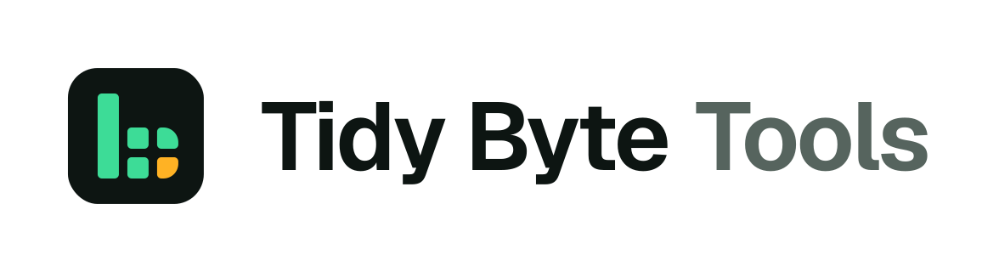

<p>
  <a href="https://github.com/tidybytetools">
    <picture>
      <source media="(prefers-color-scheme: dark)" srcset="https://raw.githubusercontent.com/tidybytetools/link-check-lite/main/assets/tidybytetools-lockup-dark.png">
      
    </picture>
  </a>
</p>

# link-check-lite

[](https://github.com/tidybytetools/link-check-lite/blob/main/LICENSE)
[](https://www.python.org/)
[](#use-it-with-your-ai-app-mcp)
[](https://registry.modelcontextprotocol.io/v0/servers?search=io.github.tidybytetools/link-check-lite)
[](https://pypistats.org/packages/link-check-lite)
[](https://glama.ai/mcp/servers/tidybytetools/link-check-lite)

**Free. No API key. Runs on your own computer. It only visits the links you give it.**

A tool that checks a list of links. It tells you which ones work, which are broken, and where redirects end up.
Need sitemaps, speed checks, sketchy-domain warnings or CSV reports? The paid version does that: **[link-check on Gumroad](https://tidybyte.gumroad.com/l/link-check)**

MIT license. Python 3.10 or newer, on Windows, Mac and Linux. The checker itself uses only Python's built-in tools.

## Links

- **[Website](https://tidybytetools.github.io/tools/link-check/)** — product page with prices and options
- **[Apify (no-install cloud version)](https://apify.com/tidybytetools/broken-link-checker)** — pay only for what you use
- **[Pro version on Gumroad](https://tidybyte.gumroad.com/l/link-check)** — sitemaps, speed checks, sketchy-domain warnings, CSV reports

<!-- mcp-name: io.github.tidybytetools/link-check-lite -->

## Install

```
pip install link-check-lite
```

Or use pipx, which keeps it in its own space:

```
pipx install link-check-lite
```

Want the newest code from GitHub instead?

```
pip install git+https://github.com/tidybytetools/link-check-lite
```

## Use it

Put your links in a text file, one per line. Lines that start with `#` are skipped.

```
link-check-lite links.txt
link-check-lite links.txt -w 3 --timeout 20   # gentler and more patient
```

Example run:

```
OK   200 https://example.com/
OK   200 https://httpbin.org/redirect/2  -> https://httpbin.org/get (2 redirects)
FAIL 404 https://example.com/old-page
FAIL --- https://no-such-site.example  ([Errno -2] Name or service not known)

4 checked, 2 ok, 2 broken
```

Exit code is 0 when every link works and 1 when any link is broken, so it works in a cron job or CI.

When you run it in a terminal it ends with one short line about the paid version. `--quiet` turns it off, and it never shows when output is piped.

## Known limits

- **Some sites block bots.** They may answer 403 or 429 even when the page opens fine in a browser.
- **No JavaScript.** Redirects done with JavaScript are not followed.
- **Text file only.** No CSV input, no sitemaps, and results print to the screen.
- **No robots.txt and no per-site rate limit.** It checks 5 links at a time with a small pause. Don't point it at thousands of pages on one site.
- **Not a safety check.** It does not tell you if a link is a scam.

## Lite vs paid

| | lite (free) | [link-check](https://tidybyte.gumroad.com/l/link-check) |
|---|---|---|
| Status codes and broken links | yes | yes |
| Redirect chain and final URL | yes | yes |
| Text file input | yes | yes |
| CSV input and sitemap URLs (with sitemap index) | no | yes |
| Response time and slow-link flag | no | yes |
| http vs https checks | no | yes |
| Look-alike and sketchy domain warnings (local rules) | no | yes |
| robots.txt and one-hit-per-second per site | no | yes |
| CSV, JSON and Markdown reports | no | yes |

## How it compares to other free tools

All of these are free. Pick what fits you.

| | link-check-lite | [lychee](https://github.com/lycheeverse/lychee) | [linkchecker](https://github.com/linkchecker/linkchecker) | [muffet](https://github.com/raviqqe/muffet) |
|---|---|---|---|---|
| Checks a plain list of links | yes | yes | no, it crawls | no, it crawls |
| Crawls a whole site | no | no | yes | yes |
| Install | pip | binary / cargo | pip | binary / go |
| Built-in MCP server for AI apps | yes | no | no | no |
| Lots of options | no | yes | yes | yes |

If you need to crawl a big site or check links inside Markdown files, lychee and linkchecker are great.

## Use it with your AI app (MCP)

There is a small free MCP server built in. It gives your AI app one tool, `check_links`. No API key or account is needed. It needs [uv](https://docs.astral.sh/uv/), which gives you the `uvx` command.

Run it by hand to check it starts (it waits quietly for an app to talk to it):

```
uvx --from link-check-lite link-check-lite-mcp
```

Shorter way to start the same server: `uvx link-check-lite mcp`.

Pick your app below and copy the block. Restart the app after you save.

### Claude Desktop

Open **Settings > Developer > Edit Config**. That opens `claude_desktop_config.json`. Add this:

```json
{
  "mcpServers": {
    "link-check-lite": {
      "command": "uvx",
      "args": ["--from", "link-check-lite", "link-check-lite-mcp"]
    }
  }
}
```

If Claude says it can't find `uvx`, run `which uvx` (Mac/Linux) or `where uvx` (Windows) and put that full path in `"command"`.

### Cursor

Put the same block in `~/.cursor/mcp.json` (all projects) or `.cursor/mcp.json` (one project):

```json
{
  "mcpServers": {
    "link-check-lite": {
      "command": "uvx",
      "args": ["--from", "link-check-lite", "link-check-lite-mcp"]
    }
  }
}
```

### VS Code

VS Code uses `servers`, not `mcpServers`. Put this in `.vscode/mcp.json` in your project, or run **MCP: Open User Configuration** to use it everywhere:

```json
{
  "servers": {
    "link-check-lite": {
      "type": "stdio",
      "command": "uvx",
      "args": ["--from", "link-check-lite", "link-check-lite-mcp"]
    }
  }
}
```

Or add it with one command:

```
code --add-mcp '{"name":"link-check-lite","type":"stdio","command":"uvx","args":["--from","link-check-lite","link-check-lite-mcp"]}'
```

### Cline

In the Cline panel, click the **MCP Servers** icon, open **Configure**, then click **Configure MCP Servers**. Add this inside `mcpServers`:

```json
{
  "mcpServers": {
    "link-check-lite": {
      "command": "uvx",
      "args": ["--from", "link-check-lite", "link-check-lite-mcp"],
      "disabled": false,
      "autoApprove": []
    }
  }
}
```

### Codex

One command:

```
codex mcp add link-check-lite -- uvx --from link-check-lite link-check-lite-mcp
```

Or add this to `~/.codex/config.toml`:

```toml
[mcp_servers.link-check-lite]
command = "uvx"
args = ["--from", "link-check-lite", "link-check-lite-mcp"]
```

### Gemini CLI

This repo is also a Gemini CLI extension. Install it with:

```
gemini extensions install https://github.com/tidybytetools/link-check-lite
```

Tool: `check_links(urls, timeout=10.0)`. Send up to 200 links. It returns one result per link.

## Use it in GitHub Actions

[Link Check Lite is on the GitHub Marketplace.](https://github.com/marketplace/actions/link-check-lite) Check your links every time you push. Put your links in a text file, one per line. Then add this step to a workflow:

```yaml
- uses: actions/checkout@v7
- uses: tidybytetools/link-check-lite@v1
  with:
    file: links.txt          # one link per line
    # fail-on-broken: "false"  # pass even if some links are broken
```

`@v1` always points to the newest 1.x release. To stay on one exact release, use a full tag like `@v1.1.3`.

The step fails if any link is broken. It also writes a short report to the run summary. It installs link-check-lite from PyPI. Your links are sent only to the sites they point to.

### Inputs

| Input | Default | What it does |
|---|---|---|
| `file` | `links.txt` | Text file with one link per line. Lines that start with `#` are skipped. |
| `workers` | `5` | How many links to check at the same time. |
| `timeout` | `10` | Seconds to wait for each link. |
| `fail-on-broken` | `true` | Set to `false` to pass the step even when some links are broken. |
| `version` | (empty) | link-check-lite version from PyPI. Empty gets the newest. |
| `python-version` | `3.12` | Python version to set up. |

### Outputs

| Output | What it is |
|---|---|
| `checked` | How many links were checked. |
| `ok` | How many links were OK. |
| `broken` | How many links were broken. |

## Use it from Python

```python
from link_check_lite import check_link
print(check_link("https://example.com"))
# {'url': 'https://example.com', 'status': 200, 'ok': True, 'final_url': 'https://example.com', 'redirects': [], 'error': None}
```

## For AI agents

- **Use when:** you need to know if web links work and where their redirects end up.
- **Don't use when:** you need to know if a link is safe, need a whole site crawled, or need speed or https checks. Use the paid version for those.
- **Input:** a list of http(s) URLs (max 200 per MCP call), plus an optional `timeout` in seconds.
- **Output:** a list of `{url, status, ok, final_url, redirects, error}`. `status` is null when the link could not connect. `ok` is true for 200-399. `redirects` lists each hop as `"CODE url"`.
- CLI exit code is 0 when all links work and 1 when any link is broken or on error. See also [`llms.txt`](https://github.com/tidybytetools/link-check-lite/blob/main/llms.txt).

## Tests

```
pip install "mcp>=1.10,<2"
python3 -m unittest discover tests
```

The tests use a tiny local web server, so they don't need the internet.

## FAQ

**What does it check?**
A text file of links, one per line. It reports status codes, redirects, and broken links.

**Does it crawl my whole site?**
No. It only checks the links you give it. The Pro version can also read sitemaps.

**Do the links I check get sent somewhere else?**
Only to the sites those links point to. Nothing is sent to us.

**Does it work with AI apps?**
Yes. It includes a free MCP server. No API key.
## License

MIT. See `LICENSE`.
